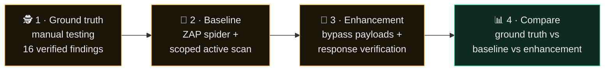
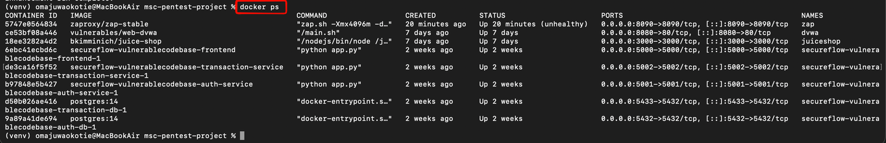
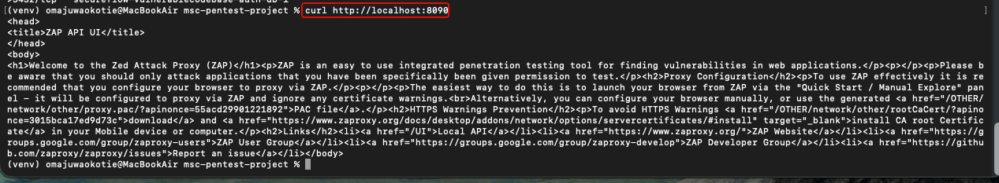
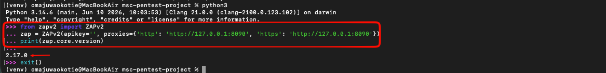
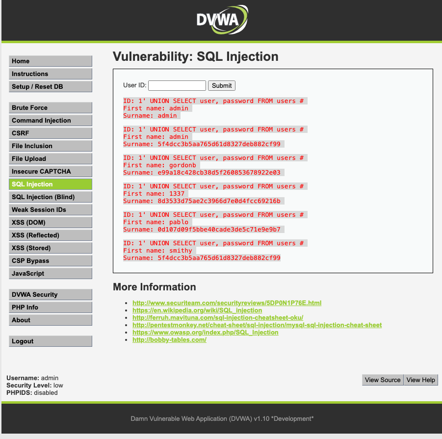
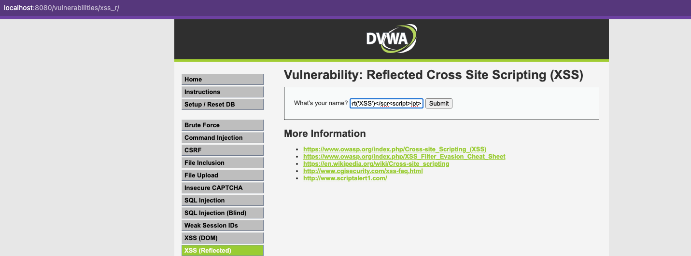
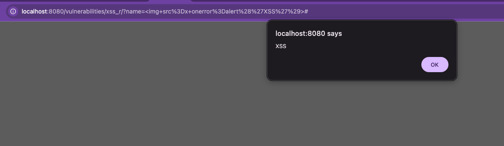
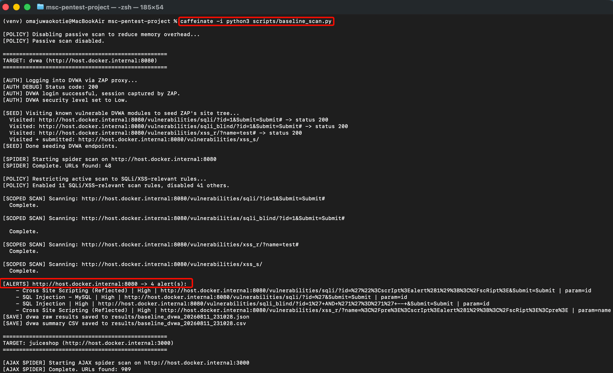
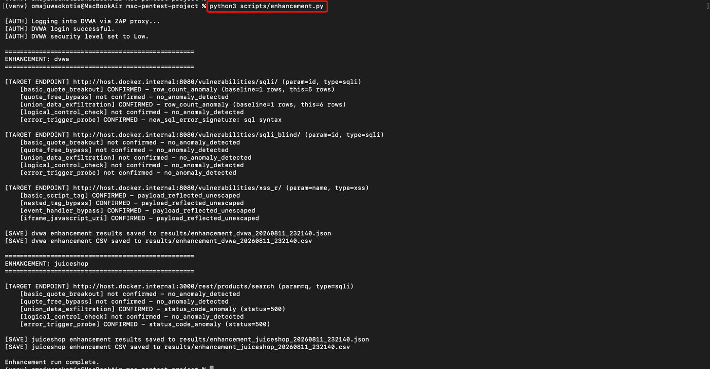

# Detecting Vulnerabilities in Web Applications: Enhancing OWASP ZAP's Detection Granularity


MSc Computer Forensics and Cybersecurity dissertation, University of Greenwich (Distinction).

Automated scanners like OWASP ZAP report **whether** a vulnerability exists. A manual tester reports **how** it can be exploited, which filters it bypasses and what an attacker can actually get. This project builds a Python verification layer on top of ZAP that re-tests flagged input points with bypass payloads learned from manual testing, and confirms exploitability by comparing each response against a safe baseline response.

**Result on DVWA (Low): ZAP alone raised 4 alerts against 8 manually verified vulnerabilities. With the enhancement layer, 7 were confirmed with evidence, including two filter-bypass XSS techniques that ZAP's default payloads never tried, and with no new false positives.**

---

## Contents

- [Research question](#research-question)
- [Method](#method)
- [Lab environment](#lab-environment)
- [Ground truth: manual testing](#ground-truth-manual-testing)
- [Baseline: ZAP on its own](#baseline-zap-on-its-own)
- [The enhancement tool](#the-enhancement-tool)
- [Results](#results)
- [Limitations](#limitations)
- [Repository structure](#repository-structure)
- [Running it yourself](#running-it-yourself)
- [Future work](#future-work)
- [Author](#author)

---

## Research question

Can a lightweight, response-verification layer built on top of OWASP ZAP move automated detection of SQL injection and cross-site scripting closer to the **technique-level and impact-level granularity** of manual testing?

ZAP's alerts are close to binary: "SQL Injection: detected". They don't say whether the injection allows data exfiltration, or whether a filter-bypass technique works against a partially defended input. That gap is what the tool targets.

---

## Method



1. **Ground truth.** Every vulnerability was first exploited by hand, so the automated results had something real to be measured against.
2. **Baseline.** ZAP ran unmodified against the same endpoints, driven through its Python API.
3. **Enhancement.** The verification layer re-tested those endpoints with an expanded payload set and evidence-based confirmation.
4. **Comparison.** All three were compared technique by technique in [`results/final_comparison.md`](results/final_comparison.md).

---

## Lab environment

Everything ran locally in Docker: **DVWA** (PHP and MySQL, with Low, Medium and High security levels) and **OWASP Juice Shop** (Node.js), with **ZAP running headless** and controlled from Python through its API on port 8090.



| ZAP API reachable | Python connected to ZAP |
| --- | --- |
|  |  |

---

## Ground truth: manual testing

**16 vulnerabilities verified by hand** (14 on DVWA across all three security levels, 2 on Juice Shop), each with the payload, the result and why it worked. Full log: [`results/ground_truth_log.md`](results/ground_truth_log.md).

What manual testing showed, and what a binary scanner alert cannot:

| Level | Defence observed | Technique that still worked |
| --- | --- | --- |
| DVWA Low | None | `1' OR '1'='1` returned all 5 users; `UNION SELECT` extracted 6 unsalted MD5 password hashes |
| DVWA Medium | Server-side quote escaping, plus a dropdown that was only a client-side restriction | Quote-free `1 OR 1=1`, sent by editing the dropdown in DevTools |
| DVWA Medium | Single-pass removal of `<script>` | Nested tags: `<scr<script>ipt>` reassembles after filtering |
| DVWA High | Output capped to one row | `UNION SELECT` still returned all 6 hashes |
| DVWA High | Stronger, regex-based `script` filter | Non-script vector: `` |
| Juice Shop | | `' OR 1=1--` logged in as administrator; `<iframe src="javascript:...">` XSS in search |

| UNION-based exfiltration of password hashes | Nested-tag bypass at Medium | `` bypass at High |
| --- | --- | --- |
|  |  |  |

**The key insight:** each security level blocks specific techniques, not the vulnerability itself. A scanner that tries only default payloads will miss what a tester finds by adapting.

---

## Baseline: ZAP on its own

[`scripts/baseline_scan.py`](scripts/baseline_scan.py) drives ZAP through its API:

- **Authenticates to DVWA through ZAP**, so the scan runs as a logged-in user.
- **Seeds known input endpoints by sending traffic through the proxy.** ZAP's active scanner can only test URLs already in its site tree, and Juice Shop's JSON login and feedback forms aren't found by the AJAX spider on its own.
- **Runs the spider and AJAX spider**, then a **scoped active scan** limited to SQLi and XSS rules (11 enabled, 41 disabled).
- **Scopes the active scan to known endpoints.** Scanning all 700+ discovered URLs repeatedly crashed ZAP out of memory, and scoping also keeps the comparison consistent with manual testing.



**Baseline result:** 4 alerts on DVWA (2 SQLi, 2 XSS) and 1 on Juice Shop (SQLi). Each was a generic detection with no technique or impact detail.

---

## The enhancement tool

[`scripts/enhancement.py`](scripts/enhancement.py) re-tests the target endpoints with payloads built from the bypass techniques confirmed in manual testing, then **confirms each one from evidence in the response**, compared against a safe baseline request.

**Payload library**

| Class | Technique | Payload |
| --- | --- | --- |
| SQLi | Basic quote breakout | `1' OR '1'='1` |
| SQLi | Quote-free bypass | `1 OR 1=1` |
| SQLi | UNION exfiltration | `1' UNION SELECT user, password FROM users #` |
| SQLi | Logical control check | `1' AND '1'='2` |
| SQLi | Error-trigger probe | `'(` |
| XSS | Basic script tag | `<script>alert('XSS')</script>` |
| XSS | Nested-tag bypass | `<scr<script>ipt>alert('XSS')</scr<script>ipt>` |
| XSS | Event-handler bypass | `` |
| XSS | iframe JavaScript URI | `<iframe src="javascript:alert('XSS')">` |

**Evidence used to confirm a finding**

| Signal | What it proves |
| --- | --- |
| **Row-count anomaly** | Counts result rows against the baseline (for example 1 to 5 rows, or 1 to 6 with UNION), proving the injected logic ran |
| **New MD5 hashes in the response** | Proves data exfiltration, not just an injection point |
| **New SQL error signature** | Only counted if it is absent from the baseline response |
| **Status-code anomaly** | For example HTTP 500 on Juice Shop search |
| **Payload reflected unescaped** | The XSS payload appears in the page without encoding |



**Four versions to get it right.** The fix history is documented in the script:

| Version | Problem | Fix |
| --- | --- | --- |
| v1 | Every request silently returned DVWA's login page | Authenticate first |
| v2 | "mysql" matched DVWA's own static reference links on every page, so everything looked vulnerable | Compare against a baseline response and count only **new** signatures |
| v3 | DVWA only runs the query with a companion `Submit=Submit` parameter | Extra parameters per endpoint |
| v4 | A 30% page-size threshold was drowned out by DVWA's large fixed page layout | Targeted row counting and new-hash detection |

---

## Results

| Target | Ground truth | ZAP baseline | Enhancement tool |
| --- | :---: | :---: | :---: |
| **DVWA (Low)** | 8 (3 SQLi, 5 XSS) | 4 alerts (2 SQLi, 2 XSS) | **7 confirmed** (3 SQLi, 4 XSS) |
| **Juice Shop** | 2 (1 SQLi, 1 XSS) | 1 alert (SQLi) | **2 confirmed** (SQLi) |

**DVWA (Low), technique by technique**

| Technique | ZAP baseline | Enhancement tool |
| --- | --- | --- |
| Basic quote breakout | Generic alert | ✅ Confirmed: rows 1 to 5 |
| UNION exfiltration | Generic alert, no exfiltration detail | ✅ Confirmed: rows 1 to 6, hashes found |
| Reflected XSS, `<script>` | Generic alert | ✅ Confirmed: reflected unescaped |
| Reflected XSS, nested-tag bypass | ❌ Not in default payloads | ✅ Confirmed |
| Reflected XSS, `` bypass | ❌ Not in default payloads | ✅ Confirmed |
| Quote-free SQLi | Not tested | ✅ Correctly **not** confirmed: at Low it is a literal string, not an injection |
| Blind SQLi | ❌ Not detected | ❌ Not detected (known limitation) |

**Key findings**

1. **More granular detection.** The tool separates "injection point" from "data exfiltration confirmed" from "filter bypass succeeded", with evidence for each. ZAP reports only "detected".
2. **Two of ZAP's three missed techniques confirmed.** Nested-tag and `` XSS were confirmed; blind SQLi was not.
3. **No new false positives.** The quote-free payload correctly failed at Low, showing the tool follows real injection mechanics rather than flagging everything.

---

## Limitations

- **Blind SQLi is not detected** by either ZAP or the tool. It needs timing-based or boolean-inference techniques, which are not implemented yet.
- **Automated testing covered DVWA Low only.** Medium and High were tested manually but not by the baseline or the tool, because of time lost to Docker networking and ZAP memory issues.
- **Two lab applications** with known vulnerabilities. Results on real applications would need further evaluation.
- **Stored XSS and Juice Shop's iframe XSS** were not re-tested by the tool in this run.

---

## Repository structure

```
.
├── scripts/
│   ├── baseline_scan.py        # ZAP spider + scoped active scan via the ZAP API
│   └── enhancement.py          # Bypass payloads + response-based verification
├── results/
│   ├── ground_truth_log.md     # 16 manually verified findings
│   ├── final_comparison.md     # Ground truth vs baseline vs enhancement
│   ├── baseline_*.json / .csv  # Raw and per-target ZAP results
│   └── enhancement_*.json / .csv
├── evidence/                   # Screenshots from manual testing, by day
├── docs/images/                # Run screenshots used in this README
└── requirements.txt
```

---

## Running it yourself

> ⚠️ DVWA and Juice Shop are **intentionally vulnerable**. Run them only locally.

```bash
# 1. Start the lab
docker run -d -p 8080:80 vulnerables/web-dvwa
docker run -d -p 3000:3000 bkimminich/juice-shop
docker run -d -p 8090:8090 zaproxy/zap-stable \
  zap.sh -daemon -host 0.0.0.0 -port 8090 \
  -config api.disablekey=true -config api.addrs.addr.name=.* -config api.addrs.addr.regex=true

# 2. Install dependencies
python3 -m venv venv && source venv/bin/activate
pip install -r requirements.txt

# 3. Run the baseline, then the enhancement
python3 scripts/baseline_scan.py
python3 scripts/enhancement.py
```

Set up the DVWA database once at `http://localhost:8080/setup.php`. Results are written to `results/` as JSON and CSV. On macOS, `caffeinate -i` keeps long scans from being interrupted by sleep.

---

## Future work

- Timing-based and boolean-inference detection for **blind SQLi**
- Run baseline and enhancement against **DVWA Medium and High**
- Feed confirmed findings **back into ZAP** as enriched alerts, or as a ZAP add-on
- Add **DOM-based XSS** using browser automation
- Evaluate on a wider set of applications

---

## Author

**Omajuwa Okotie**, MSc Computer Forensics and Cybersecurity (Distinction), University of Greenwich

Supervisor: Muhammad Taimoor Khan

[Portfolio](https://omajuwaokotie.com) · [LinkedIn](https://www.linkedin.com/in/omajuwa-okotie-850950190) · [GitHub](https://github.com/omjhub)
